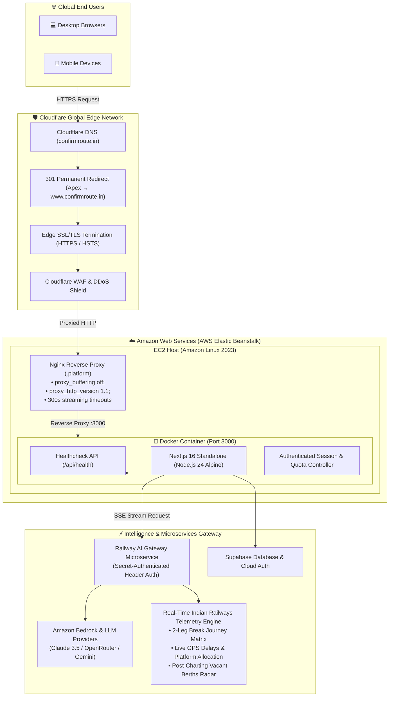
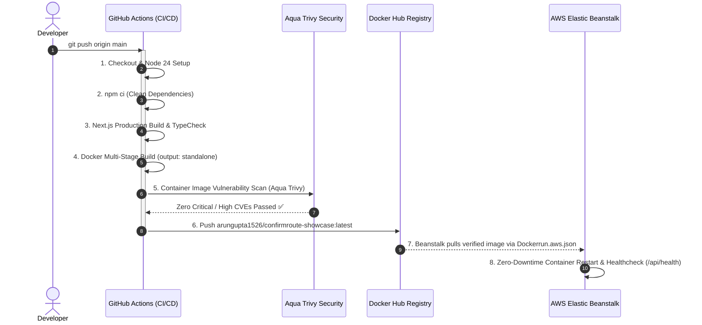

<div align="center">

# 🚆 ConfirmRoute AI — Cloud-Native Travel Intelligence Platform
### ☁️ Production Deployment on AWS Elastic Beanstalk & Cloudflare

[](https://www.confirmroute.in)
[](https://aws.amazon.com/elasticbeanstalk/)
[](https://hub.docker.com/r/arungupta1526/confirmroute-showcase)
[](https://nextjs.org/)
[](https://www.cloudflare.com/)
[](https://github.com/aquasecurity/trivy)
[](https://www.linkedin.com/company/trainwithshubham/)

<p align="center">
  <strong>Next-generation Indian Railways travel intelligence co-pilot, 2-leg break journey engine, and MCP agent.</strong><br/>
  Predict seat confirmation odds, discover 2-leg connecting trains across junction hubs when direct trains are waitlisted, monitor post-charting vacant berths in real-time, and query live GPS delay telemetry.
</p>

[🌐 Live Production Website](https://www.confirmroute.in) • [🐳 Docker Hub Image](https://hub.docker.com/r/arungupta1526/confirmroute-showcase) • [🩺 Health Endpoint](https://www.confirmroute.in/api/health)

</div>

---

## 🏆 Hackathon Overview

> **Built for the #DevOpsEvolvesIndia Hackathon organized by [TrainWithShubham](https://www.linkedin.com/company/trainwithshubham/) & Shubham Londhe.**  
> **Core Theme:** Production-grade containerization, automated multi-stage CI/CD pipelines, container vulnerability scanning, and robust deployment on **AWS Elastic Beanstalk**.

---

## 🏗️ Cloud Infrastructure & System Architecture

ConfirmRoute AI is built on a decoupled, microservices-oriented edge architecture engineered for zero-buffering AI streaming, high availability, and secure upstream proxying:



---

## 🔄 Automated CI/CD & Delivery Pipeline

Every push and release triggers an automated, secure GitHub Actions pipeline that validates code quality, builds the standalone Docker container, scans for vulnerabilities, and publishes production images:



---

## 🌟 Key Capabilities & Architectural Highlights

| Capability | Description | Technical Implementation |
| :--- | :--- | :--- |
| **2-Leg Break Journey Engine** | Finds alternative connecting trains via junction hubs (Kanpur, Prayagraj, Itarsi, etc.) with 60–240 min layovers when direct trains are sold out. | Context-aware graph search evaluating train-pair availability, departure intervals, and platform transfer windows. |
| **Real-Time GPS Telemetry** | Displays live station-by-station running position, delay minutes, and expected platform numbers. | Microservice polling railway telemetry, formatting dynamic status cards. |
| **Post-Charting Vacant Berths** | Real-time cabin, coach, and lower berth vacancy discovery after reservation chart preparation. | Live chart vacancy scraper decoding remote location quota allotments (RLWL/PQWL). |
| **Zero-Buffering AI Streaming** | Real-time token streaming and rich UI widgets without stuttering or buffering. | Nginx reverse proxy with `proxy_buffering off;` and HTTP/1.1 chunked transfer encoding. |
| **Decoupled Gateway Proxy** | Client frontend never exposes upstream microservice tokens, scrapers, or private secrets. | Server-to-server gateway communication secured with `x-gateway-secret` headers. |

---

## 🥊 Feature Comparison: ConfirmRoute AI vs. Legacy Alternatives

| Feature / Metric | ConfirmRoute AI | Standard IRCTC Portal | Where Is My Train | ConfirmTkt |
| :--- | :---: | :---: | :---: | :---: |
| **2-Leg Connecting Train Discovery** | ✅ **Automated (60–240m layovers)** | ❌ Manual search only | ❌ Not supported | ⚠️ Basic split only |
| **Post-Charting Vacant Berth Radar** | ✅ **Interactive berth type filters** | ⚠️ Clunky PDF charts | ❌ Not supported | ❌ Not supported |
| **Conversational Travel Co-Pilot** | ✅ **Natural language & MCP tools** | ❌ None | ❌ None | ❌ None |
| **Nginx SSE Streaming Optimization** | ✅ **`proxy_buffering off` configured** | ❌ Static HTTP | ❌ Native App only | ❌ Static HTTP |
| **Docker Multi-Stage Footprint** | ✅ **~180MB Alpine runtime** | ❌ Monolithic | ❌ Closed Source | ❌ Closed Source |
| **Container Security Vulnerability Scanning**| ✅ **Aqua Trivy automated CI gate** | ❓ Unknown | ❓ Unknown | ❓ Unknown |
| **Cloud Hosting Architecture** | ✅ **AWS Elastic Beanstalk + Cloudflare** | 🏢 On-prem / Hybrid | ☁️ Proprietary Cloud | ☁️ Proprietary Cloud |

---

## 🐳 Docker Containerization

The repository includes a production-grade multi-stage `Dockerfile`:

- **Stage 1 (`base`)**: Node.js 24 on Alpine Linux with libc compatibility.
- **Stage 2 (`deps`)**: Cached dependency installation with `--ignore-scripts`.
- **Stage 3 (`builder`)**: Compiles Next.js with `output: "standalone"`, extracting pruned server assets.
- **Stage 4 (`runner`)**: Unprivileged runtime user (`nextjs:1001`), trimmed build tools, stripped npm overhead, achieving a **~180MB minimal image**.

### 1-Command Local Run via Docker Compose (Recommended)
You can run the exact production container locally using Docker Compose without needing to build from source:

```bash
# Pull and start the production image from Docker Hub
docker compose up -d

# Verify container health
curl -s http://localhost:3000/api/health
```

### Manual Docker Build:
```bash
# 1. Build Docker image
docker build -t arungupta1526/confirmroute-showcase:latest .

# 2. Run container locally
docker run -p 3000:3000 --env-file .env.local arungupta1526/confirmroute-showcase:latest

# 3. Test health endpoint
curl http://localhost:3000/api/health
```

---

## ☁️ AWS Elastic Beanstalk Deployment Configuration

This repository includes custom AWS Elastic Beanstalk orchestration configs:

### 1. `Dockerrun.aws.json` (Container Descriptor)
Directs AWS Elastic Beanstalk to pull the pre-built, scanned image from Docker Hub:
```json
{
  "AWSEBDockerrunVersion": "1",
  "Image": {
    "Name": "arungupta1526/confirmroute-showcase:latest",
    "Update": "true"
  },
  "Ports": [
    {
      "ContainerPort": 3000
    }
  ]
}
```

### 2. `.platform/nginx/conf.d/proxy.conf` (Nginx Streaming Reverse Proxy)
Disables proxy buffering so Next.js AI streaming (Server-Sent Events) reaches clients without latency:
```nginx
client_max_body_size 50M;
proxy_connect_timeout 300s;
proxy_send_timeout 300s;
proxy_read_timeout 300s;
proxy_buffering off;
proxy_http_version 1.1;
```

### 3. `.ebextensions/01_healthcheck.config` (AWS Process Health Monitoring)
Configures Elastic Beanstalk to probe `/api/health` with HTTP 200 verification:
```yaml
option_settings:
  aws:elasticbeanstalk:application:
    Application Healthcheck URL: /api/health
  aws:elasticbeanstalk:environment:process:default:
    HealthCheckPath: /api/health
    MatcherHTTPCode: "200"
    Port: "80"
    Protocol: HTTP
    DeregistrationDelay: "20"
```

---

## 🛡️ Security, Privacy & Compliance

- **RFC 9116 Security Policy**: Public [`security.txt`](https://www.confirmroute.in/.well-known/security.txt) endpoint for responsible vulnerability disclosure.
- **CWE-338 Cryptographic Compliance**: Replaced pseudo-random algorithms with cryptographically secure PRNGs (`crypto.randomUUID()` and `crypto.getRandomValues()`).
- **Strict Content Security Policy (CSP)**: Hardened headers with no third-party script vulnerabilities.
- **Zero Proprietary Data Leakage**: Sensitive backend scraper endpoints, credentials, and payment gateways are completely isolated from client bundles.

---

## 📄 License & Attribution

This project is open-sourced under the **Apache 2.0 License** for the **#DevOpsEvolvesIndia** Hackathon.  

Special thanks to **[Shubham Londhe sir](https://www.linkedin.com/in/shubhamlondhe1996/)** and the **[TrainWithShubham](https://www.linkedin.com/company/trainwithshubham/)** community for mentoring, inspiring, and driving cloud DevOps excellence across India! 🇮🇳

<div align="center">
Built with ❤️ for Indian Railways travelers and DevOps engineers worldwide.
</div>
